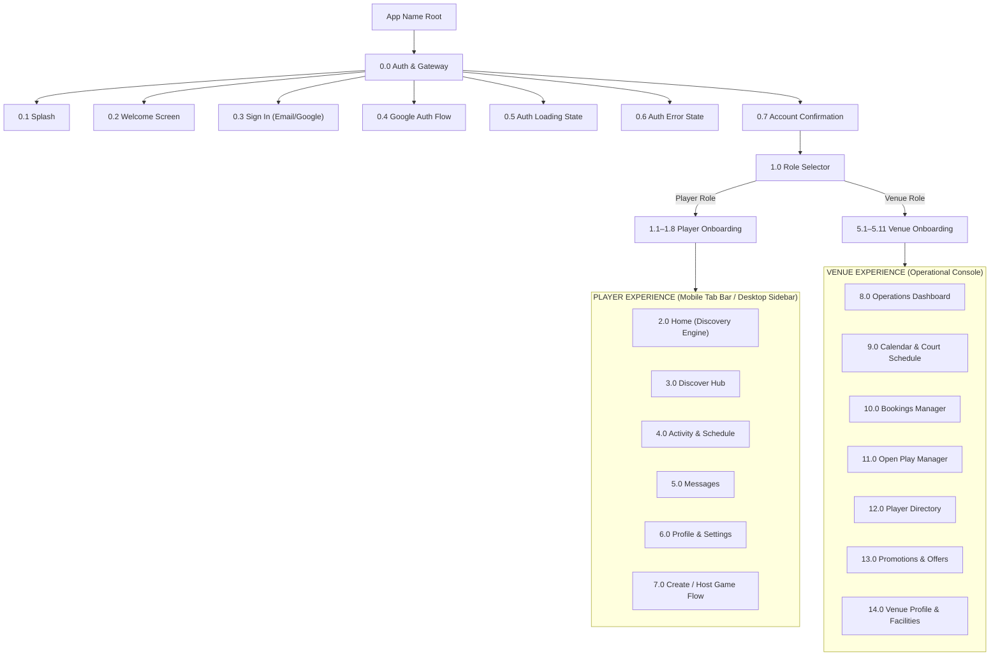
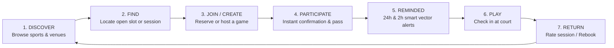
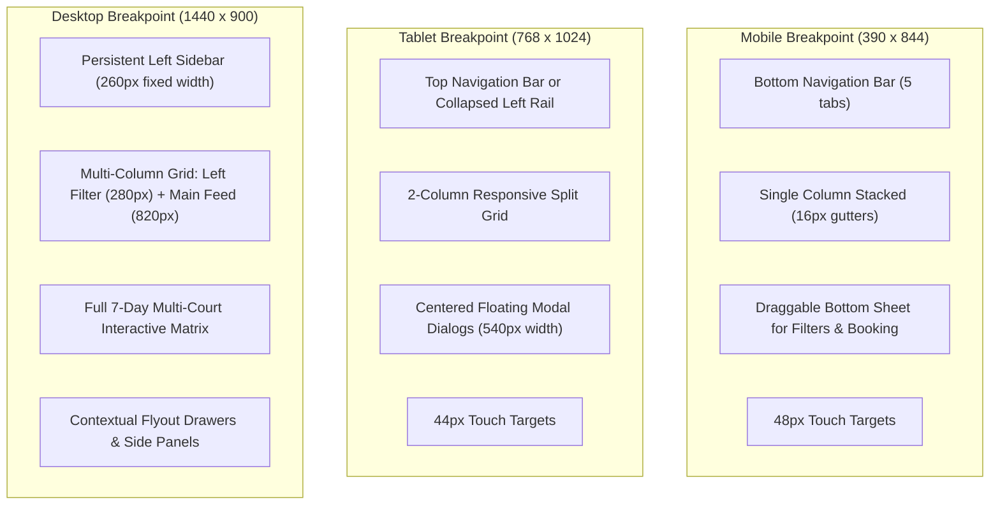
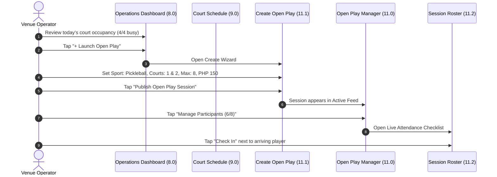

# APP NAME — COMPLETE UX/UI DESIGN SYSTEM & WIREFRAME SPECIFICATION

> **Product Statement**: *"App Name connects people and places through sport."*  
> **Brand Notice**: The brand name, logo, tagline, colors, and visual identity are temporary and fully decoupled using design tokens. The placeholder name **"App Name"** is used universally throughout this document.  
> **Iconography & Asset Standard**: 100% SVG Vector icons (Lucide icon library). Strict **Zero-Emoji** policy across all screens, navigation, chips, badges, and alerts.  
> **Design Philosophy**: Apple Human Interface Guidelines (HIG) inspired — clarity, hierarchy, predictable navigation, restrained visual aesthetics, mobile-first thumb zones, and responsive desktop adaptation.

---

# TABLE OF CONTENTS
1. [Complete Information Architecture](#1-complete-information-architecture)
2. [Complete User-Flow Map](#2-complete-user-flow-map)
3. [Complete LoFi Design System](#3-complete-lofi-design-system)
4. [Complete LoFi Wireframes (76 Screens)](#4-complete-lofi-wireframes)
   - 4.1 Authentication (7 Screens)
   - 4.2 Player Onboarding (8 Screens)
   - 4.3 Player Core Experience (34 Screens)
   - 4.4 Venue Core Experience (27 Screens)
5. [Complete Component Inventory](#5-complete-component-inventory)
6. [Complete HiFi Design System](#6-complete-hifi-design-system)
7. [Complete HiFi Wireframes & Screen Specifications (76 Screens)](#7-complete-hifi-wireframes--screen-specifications)
8. [Responsive Specifications (Mobile, Tablet, Desktop)](#8-responsive-specifications)
9. [Component States & Feedback Matrix](#9-component-states--feedback-matrix)
10. [Prototype Interaction Map](#10-prototype-interaction-map)
11. [Player Prototype Flow (Flows 1–5 & 7)](#11-player-prototype-flow)
12. [Venue Prototype Flow (Flow 6)](#12-venue-prototype-flow)
13. [Figma Organization Structure](#13-figma-organization-structure)
14. [Design Handoff & Implementation Notes](#14-design-handoff--implementation-notes)

---

# 1. COMPLETE INFORMATION ARCHITECTURE

The application architecture is structured into two dedicated primary roles: **PLAYER** and **VENUE (FACILITY OWNER)**, sharing a unified authentication foundation and global design token system.



### 1.1 Player Information Architecture
1. **Home (`/home`)**:
   - Location Selector Header + Notification Bell + Profile Avatar
   - Sport Shortcuts Carousel (Pickleball, Badminton, Basketball, Tennis, Volleyball, Football)
   - "Near You" Horizontal Card Feed (Games, Venues, Open Play)
   - Open Play Highlights ("Happening Tonight / Tomorrow")
   - Next Upcoming Activity Persistent Banner (with countdown & status)
2. **Discover (`/discover`)**:
   - Search Bar (persistent top query input with vector search icon)
   - Primary Tabs: **Sports** | **Open Play** | **Venues**
   - Progressive Filter Drawer (Sport, Location/Radius, Date, Time of Day, Skill Level, Price Range)
   - Results View (List / Map toggle)
   - Sport Details Landing Pages (`/discover/sport/:id`)
   - Venue Details Landing Pages (`/discover/venue/:id`)
   - Open Play Session Details (`/discover/open-play/:id`)
3. **Activity (`/activity`)**:
   - Segmented Switcher: **Upcoming** | **Past**
   - Upcoming Feed: Confirmed Bookings, Joined Open Plays, Hosted Games
   - Past Feed: Completed Sessions, Cancelled Sessions
   - Activity Details Modal / Page (`/activity/:id`)
   - Direct Actions: Check-in pass, Add to Calendar, Message Host/Players, Cancel/Leave, Directions
4. **Messages (`/messages`)**:
   - Unified Chat List: Game Chats (group threads for joined games) vs. Venue Inquiries (direct 1:1 threads)
   - Message Thread View (`/messages/:threadId`) with participant drawer and quick game summary header
5. **Profile (`/profile`)**:
   - Sporting Identity Header (Avatar, Name, Home Area, Member Since)
   - My Sports & Verified Skill Badges (e.g., Pickleball: Intermediate 3.5)
   - Playing Availability & Preferred Times
   - Activity Statistics (Games Played, Venues Visited — strictly personal, non-gamified)
   - Settings: Notifications, Privacy (Profile visibility), Role Switcher ("Switch to Venue Mode"), Account & Logout
6. **Create Game (`/create-game`)**:
   - Step 1: Select Sport
   - Step 2: Select Venue / Location
   - Step 3: Date & Time Window
   - Step 4: Player Count & Skill Level
   - Step 5: Game Format (Casual / Competitive / Open Play) & Cost Split
   - Step 6: Review & Publish
   - Step 7: Confirmation & Live Game Management Dashboard

### 1.2 Venue Information Architecture
1. **Operations Dashboard (`/venue/dashboard`)**:
   - Facility Switcher (if multi-location) & Real-time Operating Status
   - Today's Quick Metrics: Bookings Today, Open Play Occupancy, Courts in Use
   - Immediate Next Sessions Timeline
   - Quick Action Bar: "New Booking", "Create Open Play", "Block Court"
2. **Calendar & Court Schedule (`/venue/calendar`)**:
   - Date Navigator (Day Picker on Mobile; Full Week/Day Matrix on Desktop)
   - Court Timeline Grid (Court 1, Court 2, Court 3...)
   - Slot Blocks: Public Bookings, Open Play Sessions, Maintenance/Blocked Slots
   - Slot Detail Drawer (Player info, payment status, check-in toggle)
3. **Bookings (`/venue/bookings`)**:
   - Filterable Table / List (Date, Court, Status: Confirmed / Pending / Checked-In / Cancelled)
   - Booking Detail View with full customer history and refund/reschedule controls
4. **Open Play Manager (`/venue/open-play`)**:
   - Active Sessions List (Current capacity e.g., 6/8 slots filled)
   - Create Open Play Wizard (Sport, Court allocation, Time, Max players, Price per head, Skill requirement)
   - Live Participant Roster & Attendance Check-in
5. **Player Directory (`/venue/players`)**:
   - Regular Player Roster (Frequency, Last Visited, Preferred Sports)
   - Non-intrusive operational notes (e.g., "Prefers Court 3")
6. **Promotions & Offers (`/venue/promotions`)**:
   - Off-peak discounts, intro sessions, recurring event announcements
7. **Facility Profile & Settings (`/venue/settings`)**:
   - General Facility Info (Name, Address, Coordinates, Contact Phone/Email)
   - Courts & Surfaces Config (Sport type, indoor/outdoor, lighting)
   - Operating Hours & Holiday Schedules
   - Pricing Rules & Cancellation Policies
   - Photo Gallery & Amenities Checklist (Parking, Showers, Equipment Rental, Water)

---

# 2. COMPLETE USER-FLOW MAP

### 2.1 The Core Product Loop


### 2.2 Global Flow Matrix
| Flow ID | Flow Name | Primary Actor | Entry Screen | Final Target Screen | Key Decision Points / Gates |
| :--- | :--- | :--- | :--- | :--- | :--- |
| **FLOW 1** | New Player Onboarding | First-time Player | Welcome (`0.2`) | Player Home (`2.0`) | Google Auth vs Email; Sport selection (min 1); Location permission |
| **FLOW 2** | Find & Join Open Play | Player | Player Home (`2.0`) | Activity Upcoming (`4.1`) | Filter by sport/time; Check slot availability; Accept rules & pay |
| **FLOW 3** | Find Venue & Reserve Court | Player | Discover (`3.0`) | Activity Upcoming (`4.1`) | Select venue; Pick available court & 60/90min slot; Confirm reservation |
| **FLOW 4** | Host / Create a Game | Player | Home CTA / Tab | Game Management (`7.8`) | Select public venue vs private court; Max slots; Skill level gate |
| **FLOW 5** | Manage Activity & Reminders | Player | Activity (`4.0`) | Game Chat (`5.2`) | View 24h/2h reminder; Access directions; Chat with attendees; Cancel |
| **FLOW 6** | Venue Owner Daily Operations | Venue Owner | Venue Dash (`8.0`) | Open Play Roster (`11.4`) | Check-in arrivals; Block court for maintenance; Launch open play |
| **FLOW 7** | Universal Search & Filter | Player / Venue | Search Input (`3.1`) | Details Page (`3.5` / `3.7`) | Query match across sports, venues, sessions; Filter by distance/time |

---

# 3. COMPLETE LOFI DESIGN SYSTEM

The Low-Fidelity design system is engineered purely in neutral grayscales to establish uncompromised information hierarchy, component boundaries, spacing harmony, and interaction mechanics prior to visual styling.

### 3.1 LoFi Design Tokens
```css
/* LoFi Neutral Tokens */
--lofi-bg: #F7F7F5;              /* Base canvas */
--lofi-surface: #FFFFFF;         /* Card / container fill */
--lofi-surface-subtle: #EFEFEF;  /* Subdued section fill / badge bg */
--lofi-surface-skeleton: #E0E0DC;/* Loading wireframe placeholders */
--lofi-border: #D1D1CB;          /* Wireframe bounding strokes */
--lofi-border-focus: #111111;    /* Focused / selected boundary */
--lofi-text-primary: #111111;     /* Primary headings and labels */
--lofi-text-secondary: #666666;   /* Sub-labels, metadata, helpers */
--lofi-text-disabled: #A8A8A2;    /* Inactive / disabled content */
```

### 3.2 LoFi Spacing & Grid System (8pt Base)
- **Grid Units**:
  - `space-1`: 4px (tight groupings, badge padding)
  - `space-2`: 8px (icon-to-text spacing, input vertical padding)
  - `space-3`: 12px (card internal padding - compact)
  - `space-4`: 16px (standard card padding, screen horizontal edge padding on mobile)
  - `space-5`: 20px (stacked content spacing)
  - `space-6`: 24px (section headers, modal padding)
  - `space-8`: 32px (large section separations)
  - `space-12`: 48px (screen top/bottom margins, minimum mobile touch target)
  - `space-16`: 64px (desktop layout padding)

### 3.3 LoFi Typography Hierarchy
| Scale Name | Size | Line Height | Weight | Letter Spacing | Purpose |
| :--- | :--- | :--- | :--- | :--- | :--- |
| **Display** | 32px | 38px | 600 (SemiBold) | -0.5px | Splash headings, Welcome title |
| **H1** | 24px | 30px | 600 (SemiBold) | -0.3px | Screen primary title, Venue name |
| **H2** | 20px | 26px | 600 (SemiBold) | -0.2px | Section titles, Modal headers |
| **H3** | 17px | 22px | 600 (SemiBold) | 0.0px | Card titles, Grouping headers |
| **Title / Subhead**| 15px | 20px | 500 (Medium) | 0.0px | Component headers, Input labels |
| **Body** | 15px | 22px | 400 (Regular) | 0.0px | Primary descriptions, body text |
| **Body Small** | 13px | 18px | 400 (Regular) | 0.0px | Metadata, timestamps, helper text |
| **Caption** | 11px | 14px | 400 (Regular) | +0.2px | Badges, bottom tab labels, tags |
| **Label / Action**| 13px | 16px | 600 (SemiBold) | +0.5px | Button text, Filter chips (Uppercase) |

### 3.4 LoFi Wireframe Structural Conventions
1. **Images & Photos**: Displayed as rectangular containers with neutral fill (`--lofi-surface-subtle`), a subtle diagonal cross stroke (`[ X ]`), and a center Lucide `Image` vector icon.
2. **Avatars & Players**: Displayed as circular containers with `--lofi-surface-subtle` fill, a 1px border, and a center Lucide `User` icon or 2-letter uppercase initials.
3. **Buttons & Actions**: High-contrast wireframe boxes with 8px radius; primary buttons have solid dark fill with white text; secondary buttons have white surface with 1.5px border.
4. **Icons**: Lucide vector icons rendered at 1.5px stroke weight in exact bounding boxes (16px, 20px, or 24px). No raster assets. No emojis.

---

# 4. COMPLETE LOFI WIREFRAMES

Below is the structural wireframe blueprint for all 76 screens in the application inventory.

```
================================================================================
4.1 AUTHENTICATION SCREENS (7 SCREENS)
================================================================================

[SCREEN 0.1: SPLASH]
+------------------------------------------+
| 390 x 844                        [ 9:41] |
|                                          |
|                                          |
|                                          |
|                  [ o ]                   |
|                APP NAME                  |
|                                          |
|       "Connects people and places        |
|             through sport"               |
|                                          |
|                                          |
|                                          |
|                                          |
|                 ( * )                    |
|             [Spinner 24px]               |
+------------------------------------------+
Structure:
- Centered Vector Brand Symbol [ o ] (48x48)
- App Name Display text (24px, SemiBold)
- Subtitle tagline (15px Body, muted)
- Loading spinner indicating session token evaluation

[SCREEN 0.2: WELCOME]
+------------------------------------------+
| 390 x 844                        [ 9:41] |
|                                          |
|  +------------------------------------+  |
|  | [ X ] HERO WIREFRAME ILLUSTRATION  |  |
|  |     (People Playing Sports)        |  |
|  |     Height: 320px                  |  |
|  +------------------------------------+  |
|                                          |
|  Find places to play.                    |
|  Meet people to play with.               |
|  Join games near you.                    |
|                                          |
|  +------------------------------------+  |
|  | [ G ] Continue with Google         |  |  <- Primary Google Auth CTA
|  +------------------------------------+  |
|                                          |
|  +------------------------------------+  |
|  | Continue with Email                |  |  <- Secondary Outline CTA
|  +------------------------------------+  |
|                                          |
|  By continuing you agree to Terms & Privacy|
+------------------------------------------+

[SCREEN 0.3: SIGN IN]
+------------------------------------------+
| [ <- Back ]                              |
|                                          |
| Sign In                                  |
| Access your App Name account             |
|                                          |
| Email Address                            |
| [ alex.turner@example.com              ] |
|                                          |
| Password                                 |
| [ **********                     [Eye] ] |
|                                          |
| [ Forgot password? ]                     |
|                                          |
| +--------------------------------------+ |
| | Sign In                              | |
| +--------------------------------------+ |
|                                          |
| ---------------- or ------------------   |
|                                          |
| +--------------------------------------+ |
| | [ G ] Continue with Google           | |
| +--------------------------------------+ |
|                                          |
| Don't have an account? [ Create one ]    |
+------------------------------------------+

[SCREEN 0.4: GOOGLE AUTHENTICATION MODAL]
+------------------------------------------+
| ======================================== |
| Bottom Sheet / Native Auth Sheet         |
|                                          |
| [ G ] Sign in with Google                |
| Choose an account to continue to App Name|
|                                          |
| +--------------------------------------+ |
| | ( User ) Alex Turner                 | |
| |          alex.turner@gmail.com       | |
| +--------------------------------------+ |
| | ( User ) Alex (Work)                 | |
| |          aturner@company.org         | |
| +--------------------------------------+ |
| | [ + ] Use another account            | |
| +--------------------------------------+ |
|                                          |
| To continue, Google will share your      |
| name, email address, and profile picture.|
|                                          |
| [ Cancel ]                               |
+------------------------------------------+

[SCREEN 0.5: AUTHENTICATION LOADING]
+------------------------------------------+
|                                          |
|                                          |
|                 ( * )                    |
|            Connecting...                 |
|                                          |
|     Verifying your credentials with      |
|              Google Auth                 |
|                                          |
+------------------------------------------+

[SCREEN 0.6: AUTHENTICATION ERROR]
+------------------------------------------+
| [ X Close ]                              |
|                                          |
|                 [ ! ]                    |
|            (Alert Circle)                |
|                                          |
|         Unable to Sign In                |
|                                          |
| We could not verify your Google account. |
| Please check your network connection and |
| try again.                               |
|                                          |
| +--------------------------------------+ |
| | Try Again                            | |
| +--------------------------------------+ |
|                                          |
| +--------------------------------------+ |
| | Use Email Instead                    | |
| +--------------------------------------+ |
+------------------------------------------+

[SCREEN 0.7: ACCOUNT CONFIRMATION]
+------------------------------------------+
|                                          |
|                 [ Check ]                |
|               (Check Circle)             |
|                                          |
|         Account Connected                |
|                                          |
| Signed in as alex.turner@gmail.com.      |
| Let's set up your sports profile.        |
|                                          |
| +--------------------------------------+ |
| | Get Started                          | |
| +--------------------------------------+ |
+------------------------------------------+

================================================================================
4.2 PLAYER ONBOARDING SCREENS (8 SCREENS)
================================================================================

[SCREEN 1.1: ACCOUNT TYPE SELECTOR]
+------------------------------------------+
| Step 1 of 8                      [Skip]  |
|                                          |
| How will you use App Name?               |
| Select your primary account profile.     |
|                                          |
| +--------------------------------------+ |
| | [ User Icon ]                        | |
| | I am a Player                        | |
| | Discover games, join open plays,     | |
| | find people, and book courts.        | |
| |                              ( o )   | |
| +--------------------------------------+ |
|                                          |
| +--------------------------------------+ |
| | [ Building Icon ]                    | |
| | I own / manage a Venue               | |
| | List facilities, manage courts,      | |
| | host open plays, and take bookings.  | |
| |                              (   )   | |
| +--------------------------------------+ |
|                                          |
| +--------------------------------------+ |
| | Continue                             | |
| +--------------------------------------+ |
+------------------------------------------+

[SCREEN 1.2: PLAYER PROFILE]
+------------------------------------------+
| [ <- Back ]               Step 2 of 8    |
|                                          |
| Set up your profile                      |
| Help other players recognize you.        |
|                                          |
|                 ( User )                 |
|              [ Camera Icon ]             |
|              Upload Photo                |
|                                          |
| Full Name                                |
| [ Alex Turner                          ] |
|                                          |
| Display Handle                           |
| [ @alexturner                          ] |
|                                          |
| Primary Area / City                      |
| [ [ MapPin ] Taguig City, Metro Manila ] |
|                                          |
| +--------------------------------------+ |
| | Continue                             | |
| +--------------------------------------+ |
+------------------------------------------+

[SCREEN 1.3: SPORTS SELECTION]
+------------------------------------------+
| [ <- Back ]               Step 3 of 8    |
|                                          |
| What do you play?                        |
| Select all sports you're interested in.  |
|                                          |
| [ Pick 1 or more ]                       |
|                                          |
| +-------------------+ +----------------+ |
| | [ Lucide Racket ] | | [ Lucide Zap ] | |
| | Pickleball   [v]  | | Badminton  [v] | |
| +-------------------+ +----------------+ |
| +-------------------+ +----------------+ |
| | [ Lucide Circle ] | | [ Lucide Disc] | |
| | Basketball   [ ]  | | Tennis     [v] | |
| +-------------------+ +----------------+ |
| +-------------------+ +----------------+ |
| | [ Lucide Shield ] | | [ Lucide Globe]| |
| | Volleyball   [ ]  | | Football   [ ] | |
| +-------------------+ +----------------+ |
| +--------------------------------------+ |
| | [ + ] Other Sport                    | |
| +--------------------------------------+ |
|                                          |
| +--------------------------------------+ |
| | Continue (3 selected)                | |
| +--------------------------------------+ |
+------------------------------------------+

[SCREEN 1.4: SKILL LEVEL CONFIGURATION]
+------------------------------------------+
| [ <- Back ]               Step 4 of 8    |
|                                          |
| Your Skill Levels                        |
| Ensures fair and competitive matches.    |
|                                          |
| Pickleball                               |
| [ Beginner ]  [*Intermediate*]  [Advanced]|
| DUPR ~3.0 - 3.5: Consistent serve & dink |
|                                          |
| Badminton                                |
| [*Beginner*]  [ Intermediate ]  [Advanced]|
| Casual play, learning footwork & clears  |
|                                          |
| Tennis                                   |
| [ Beginner ]  [*Intermediate*]  [Advanced]|
| NTRP ~3.0: Sustains medium rallies       |
|                                          |
| +--------------------------------------+ |
| | Continue                             | |
| +--------------------------------------+ |
+------------------------------------------+

[SCREEN 1.5: AVAILABILITY PREFERENCES]
+------------------------------------------+
| [ <- Back ]               Step 5 of 8    |
|                                          |
| When are you usually free?               |
| We will highlight games that fit you.    |
|                                          |
| Days of Week                             |
| [ Weekdays ]         [ *Weekends* ]      |
|                                          |
| Preferred Times                          |
| [   ] Morning       (6:00 AM - 11:00 AM) |
| [ v ] Afternoon     (1:00 PM - 5:00 PM)  |
| [ v ] Evening       (6:00 PM - 10:00 PM) |
| [   ] Late Night    (10:00 PM+)          |
|                                          |
| +--------------------------------------+ |
| | Continue                             | |
| +--------------------------------------+ |
+------------------------------------------+

[SCREEN 1.6: PLAYING PREFERENCES]
+------------------------------------------+
| [ <- Back ]               Step 6 of 8    |
|                                          |
| What vibe are you looking for?           |
| Select match formats you enjoy.          |
|                                          |
| [ v ] Open Play Sessions                 |
|       Drop-in rotational games           |
|                                          |
| [ v ] Casual / Social                    |
|       Friendly rallies, post-game chats  |
|                                          |
| [   ] Competitive / Ranked               |
|       Score-tracked, tournament style    |
|                                          |
| [   ] Drills / Coaching                  |
|       Skill improvement and practice     |
|                                          |
| +--------------------------------------+ |
| | Continue                             | |
| +--------------------------------------+ |
+------------------------------------------+

[SCREEN 1.7: LOCATION & DISTANCE]
+------------------------------------------+
| [ <- Back ]               Step 7 of 8    |
|                                          |
| Where do you want to play?               |
| Set your search radius for activities.   |
|                                          |
| +--------------------------------------+ |
| | [ MapPin ] Use Current Location      | |
| +--------------------------------------+ |
|                                          |
| Preferred Center Area                    |
| [ BGC / Taguig, Metro Manila         ]   |
|                                          |
| Maximum Travel Distance                  |
| [======o-----------------------------]   |
| 10 km radius                             |
|                                          |
| +--------------------------------------+ |
| | Continue                             | |
| +--------------------------------------+ |
+------------------------------------------+

[SCREEN 1.8: ONBOARDING COMPLETION]
+------------------------------------------+
|                           Step 8 of 8    |
|                                          |
|                 [ Check ]                |
|                                          |
|            You're ready to play!         |
|                                          |
| We found 14 active games and 6 venues    |
| matching your sports near Taguig City.   |
|                                          |
| +--------------------------------------+ |
| | Explore Games & Venues               | |
| +--------------------------------------+ |
+------------------------------------------+

================================================================================
4.3 PLAYER CORE EXPERIENCE (34 SCREENS)
================================================================================

[SCREEN 2.0: PLAYER HOME]
+------------------------------------------+
| [MapPin] BGC, Taguig [v]       [Bell] (U)|
| Good morning, Alex                       |
| Ready to play today?                     |
|                                          |
| NEXT UPCOMING SESSION (ACTIVE BANNER)    |
| +--------------------------------------+ |
| | [Badge: Confirmed] Tonight, 7:00 PM  | |
| | Pickleball Open Play @ Downtown Club | |
| | Court 2 * 6/8 Players * [Pass QR]   | |
| +--------------------------------------+ |
|                                          |
| WHAT DO YOU WANT TO PLAY?                |
| [All] [Pickleball] [Badminton] [Tennis]  |
|                                          |
| HAPPENING TONIGHT (OPEN PLAY)   [See All]|
| +-------------------+ +----------------+ |
| | [X] Image         | | [X] Image      | |
| | Pickleball Int.   | | Badminton Dbls | |
| | 7:00 PM * 5/8 ply | | 8:00 PM * 3/4  | |
| | Downtown Club     | | Riverside Ctr  | |
| | PHP 150  [JOIN]   | | PHP 120 [JOIN] | |
| +-------------------+ +----------------+ |
|                                          |
| VENUES NEAR YOU                 [See All]|
| +--------------------------------------+ |
| | [X] 120px | Downtown Pickleball Club | |
| |           | 4 Courts * Indoor * 1.2km| |
| |           | Open until 11:00 PM      | |
| +--------------------------------------+ |
|                                          |
| [Home]  [Discover]  [Activity] [Msg] [Pro] |
+------------------------------------------+

[SCREEN 3.0: DISCOVER HUB]
+------------------------------------------+
| Discover                                 |
| [ Search sports, venues, or games... ]   |
|                                          |
| [SPORTS]       [*OPEN PLAY*]     [VENUES]|
|                                          |
| Active Filters:                          |
| [Sport: Pickleball (x)] [Tonight (x)] [+]|
|                                          |
| 8 Open Sessions Found                    |
|                                          |
| +--------------------------------------+ |
| | [X] Image 80h                        | |
| | PICKLEBALL * Intermediate 3.5        | |
| | Today, 7:00 PM - 9:00 PM (2 hrs)     | |
| | Downtown Pickleball Club (Court 1-2) | |
| | 6 / 8 Slots Filled                   | |
| | Host: Downtown Sports                | |
| | PHP 150 / person           [ JOIN ]  | |
| +--------------------------------------+ |
|                                          |
| +--------------------------------------+ |
| | [X] Image 80h                        | |
| | PICKLEBALL * Casual Open Play        | |
| | Tomorrow, 8:00 AM - 10:00 AM         | |
| | Active Arena Taguig (Court 4)        | |
| | 4 / 8 Slots Filled                   | |
| | PHP 120 / person           [ JOIN ]  | |
| +--------------------------------------+ |
|                                          |
| [Home]  [*Discover*] [Activity] [Msg] [Pro]|
+------------------------------------------+

[SCREEN 3.1: SEARCH SCREEN]
+------------------------------------------+
| [ <- Back ]                              |
| [ [Search] Pickleball BGC          [X] ] |
|                                          |
| RECENT SEARCHES                          |
| [ Clock ] Downtown Pickleball      [ x ] |
| [ Clock ] Badminton Court Manila   [ x ] |
| [ Clock ] Open Play Tonight        [ x ] |
|                                          |
| POPULAR NEAR YOU                         |
| [ Tag ] Pickleball Open Play             |
| [ Tag ] Badminton doubles                |
| [ Tag ] Indoor Tennis courts             |
+------------------------------------------+

[SCREEN 3.2: SEARCH RESULTS]
+------------------------------------------+
| [ <- Back ]                              |
| [ [Search] Pickleball BGC          [X] ] |
|                                          |
| [All (12)]   [Venues (3)]   [Games (9)]  |
|                                          |
| VENUES                                   |
| +--------------------------------------+ |
| | [X] Downtown Pickleball Club         | |
| |     BGC, Taguig * 1.2 km away        | |
| +--------------------------------------+ |
|                                          |
| OPEN GAMES                               |
| +--------------------------------------+ |
| | Tonight 7:00 PM * Intermediate       | |
| | Downtown Club * 6/8 slots * PHP 150  | |
| +--------------------------------------+ |
+------------------------------------------+

[SCREEN 3.3: SEARCH EMPTY STATE]
+------------------------------------------+
| [ <- Back ]                              |
| [ [Search] Rugby Taguig            [X] ] |
|                                          |
|                 [SearchX]                |
|              No Results Found            |
|                                          |
| We couldn't find any activities or venues|
| matching "Rugby Taguig".                 |
|                                          |
| Suggestions:                             |
| - Try broadening your search radius      |
| - Browse popular sports like Pickleball  |
|                                          |
| [ Clear Search ]                         |
+------------------------------------------+

[SCREEN 3.4: SEARCH ERROR STATE]
+------------------------------------------+
| [ <- Back ]                              |
| [ [Search] Badminton               [X] ] |
|                                          |
|                 [Alert]                  |
|         Search Temporarily Down          |
|                                          |
| We are having trouble fetching search    |
| results. Please check your connection.   |
|                                          |
| [ Retry Search ]                         |
+------------------------------------------+

[SCREEN 3.5: SPORT RESULTS (PICKLEBALL)]
+------------------------------------------+
| [ <- Back ]                    [ Share ] |
| PICKLEBALL IN METRO MANILA               |
|                                          |
| [Filter: All Levels] [Date: Any] [Near]  |
|                                          |
| +--------------------------------------+ |
| | 14 Open Games Available This Week    | |
| +--------------------------------------+ |
|                                          |
| TOP VENUES FOR PICKLEBALL                |
| +------------------+ +-----------------+ |
| | [X] Downtown Club| | [X] Active Arena| |
| | 4 Courts * 1.2km | | 6 Courts * 3.4km| |
| +------------------+ +-----------------+ |
|                                          |
| UPCOMING OPEN SESSIONS                   |
| +--------------------------------------+ |
| | Tonight 7:00 PM * 6/8 filled * PHP150| |
| +--------------------------------------+ |
+------------------------------------------+

[SCREEN 3.6: SPORT DETAILS]
+------------------------------------------+
| [ <- Back ]                    [ Share ] |
| About Pickleball                         |
|                                          |
| +--------------------------------------+ |
| | [X] HERO BANNER (Court Illustration) | |
| +--------------------------------------+ |
|                                          |
| Fast-paced paddle sport combining        |
| elements of tennis, badminton, & pingpong|
| Played on a badminton-sized court.       |
|                                          |
| COMMON FORMATS                           |
| - Open Play (Rotational doubles)         |
| - Fixed Doubles Match                    |
| - Singles Rally                          |
|                                          |
| EQUIPMENT NEEDED                         |
| Paddle + Indoor/Outdoor ball             |
|                                          |
| [ Find Pickleball Games Near Me ]        |
+------------------------------------------+

[SCREEN 3.7: VENUE RESULTS]
+------------------------------------------+
| [ <- Back ]                     [ Filter]|
| Venues (18 facilities nearby)            |
|                                          |
| +--------------------------------------+ |
| | [X] HERO IMAGE 120px                 | |
| | Downtown Pickleball Club             | |
| | BGC, Taguig * 1.2 km * 4.9 (42)      | |
| | Sports: Pickleball, Badminton        | |
| | Available Today: 3 courts open       | |
| | From PHP 350 / hr                    | |
| +--------------------------------------+ |
|                                          |
| +--------------------------------------+ |
| | [X] HERO IMAGE 120px                 | |
| | Riverside Badminton Center           | |
| | Pasig City * 3.8 km * 4.7 (88)       | |
| | Sports: Badminton                    | |
| | Available Today: 5 courts open       | |
| | From PHP 250 / hr                    | |
| +--------------------------------------+ |
+------------------------------------------+

[SCREEN 3.8: VENUE DETAILS]
+------------------------------------------+
| [ <- Back ]           [Heart]    [Share] |
| +--------------------------------------+ |
| | [ X ] VENUE CAROUSEL IMAGE (200px)   | |
| +--------------------------------------+ |
| Downtown Pickleball Club                 |
| 32nd St, BGC, Taguig City                |
| [MapPin] 1.2 km away * [Clock] 6am-11pm  |
|                                          |
| SPORTS OFFERED                           |
| [Pickleball (4 courts)] [Badminton (2)]  |
|                                          |
| AMENITIES                                |
| [v] Indoor Air-conditioned  [v] Showers  |
| [v] Paddle Rental           [v] Parking  |
|                                          |
| SESSIONS AT THIS VENUE                   |
| - Tonight 7:00 PM Open Play (6/8 slots)  |
| - Tomorrow 9:00 AM Open Play (2/8 slots) |
|                                          |
| BOTTOM ACTION BAR                        |
| +--------------------------------------+ |
| | [ View Open Play ]  [ Book a Court ] | |
| +--------------------------------------+ |
+------------------------------------------+

[SCREEN 3.9: VENUE AVAILABILITY]
+------------------------------------------+
| [ <- Back ]           Venue Availability |
| Downtown Pickleball Club                 |
|                                          |
| Select Date                              |
| [<] Today (Wed 24) [Thu 25] [Fri 26] [>] |
|                                          |
| Court 1 (Indoor Pickleball)              |
| [ 5:00 PM Booked ]  [ 6:00 PM Booked ]   |
| [ 7:00 PM Open Play ]                    |
| [*8:00 PM Available - PHP 400*]          |
| [ 9:00 PM Available - PHP 400 ]          |
|                                          |
| Court 2 (Indoor Pickleball)              |
| [*6:00 PM Available - PHP 400*]          |
| [ 7:00 PM Open Play ]                    |
|                                          |
| [ Continue to Reserve Selected Slot ]    |
+------------------------------------------+

[SCREEN 3.10: OPEN PLAY RESULTS]
+------------------------------------------+
| [ <- Back ]                    [ Filter] |
| Open Play Sessions                       |
| Drop-in games matching your sports       |
|                                          |
| [All Sports]  [Today]  [Intermediate]   |
|                                          |
| +--------------------------------------+ |
| | PICKLEBALL * Intermediate 3.0-3.5    | |
| | Today 7:00 PM - 9:00 PM              | |
| | Downtown Pickleball Club (Court 1)   | |
| | 6 / 8 Players Joined                 | |
| | Host: Downtown Sports Club           | |
| | PHP 150 / slot             [ JOIN ]  | |
| +--------------------------------------+ |
|                                          |
| +--------------------------------------+ |
| | BADMINTON * Casual All-Levels        | |
| | Today 8:00 PM - 10:00 PM             | |
| | Riverside Sports Arena (Court 3)     | |
| | 3 / 6 Players Joined                 | |
| | PHP 120 / slot             [ JOIN ]  | |
| +--------------------------------------+ |
+------------------------------------------+

[SCREEN 3.11: OPEN PLAY DETAILS]
+------------------------------------------+
| [ <- Back ]                    [ Share ] |
| Pickleball Open Play                     |
| Hosted by Downtown Sports Club           |
|                                          |
| SESSION INFO                             |
| Date: Wednesday, Tonight                 |
| Time: 7:00 PM - 9:00 PM (2 hours)        |
| Venue: Downtown Pickleball Club          |
| Court: Court 1 & Court 2                 |
| Level: Intermediate (3.0 - 3.5)          |
|                                          |
| PLAYERS JOINED (6 / 8)                   |
| (U1) (U2) (U3) (U4) (U5) (U6) [2 Open]   |
| [ View Participant List (6) -> ]         |
|                                          |
| SESSION RULES & FORMAT                   |
| - Rotational doubles (games to 11 win by2)|
| - Winners stay on, max 2 consecutive     |
| - Balls provided; paddles for rent       |
|                                          |
| PRICE                                    |
| PHP 150 per player                       |
|                                          |
| +--------------------------------------+ |
| | Join Session (PHP 150)               | |
| +--------------------------------------+ |
+------------------------------------------+

[SCREEN 3.12: PARTICIPANTS LIST]
+------------------------------------------+
| [ <- Back ]            Participants (6)  |
| Pickleball Open Play * Tonight 7:00 PM   |
|                                          |
| HOST                                     |
| ( D ) Downtown Sports Club (Verified)    |
|                                          |
| CONFIRMED PLAYERS (6 / 8)                |
| ( U ) Marcus Cruz       * Level 3.5      |
| ( U ) Sarah Jenkins     * Level 3.0      |
| ( U ) David Kim         * Level 3.5      |
| ( U ) Elena Rostova     * Level 3.0      |
| ( U ) Kenji Sato        * Level 3.5      |
| ( U ) Maria Santos      * Level 3.0      |
|                                          |
| REMAINING SLOTS (2)                      |
| [ Slot 7 - Available ]                   |
| [ Slot 8 - Available ]                   |
+------------------------------------------+

[SCREEN 3.13: JOIN CONFIRMATION]
+------------------------------------------+
| [ Cancel ]           Review Reservation  |
|                                          |
| Pickleball Open Play (Intermediate)      |
| Tonight, 7:00 PM - 9:00 PM               |
| Downtown Pickleball Club (Court 1-2)     |
|                                          |
| PLAYER                                   |
| Alex Turner (You) - Level 3.5            |
|                                          |
| PAYMENT BREAKDOWN                        |
| Session Slot Fee:            PHP 150.00  |
| Facility Service Fee:          PHP 0.00  |
| Total Due:                   PHP 150.00  |
|                                          |
| CANCELLATION POLICY                      |
| Full refund if cancelled up to 2 hours   |
| before start time.                       |
|                                          |
| +--------------------------------------+ |
| | Confirm & Join Game                  | |
| +--------------------------------------+ |
+------------------------------------------+

[SCREEN 3.14: JOIN SUCCESS STATE]
+------------------------------------------+
|                                          |
|                 [ Check ]                |
|             You're in the Game!          |
|                                          |
| Pickleball Open Play                     |
| Tonight, 7:00 PM @ Downtown Club         |
|                                          |
| A reminder has been scheduled for        |
| 5:00 PM (2 hours prior).                 |
|                                          |
| +--------------------------------------+ |
| | View in My Activity                  | |
| +--------------------------------------+ |
|                                          |
| +--------------------------------------+ |
| | Add to Calendar                      | |
| +--------------------------------------+ |
+------------------------------------------+

[SCREEN 4.0: ACTIVITY HOME]
+------------------------------------------+
| Activity                                 |
|                                          |
| [*UPCOMING (1)*]             [PAST (8)]  |
|                                          |
| NEXT UPCOMING SESSION                    |
| +--------------------------------------+ |
| | [Status: Confirmed] Tonight, 7:00 PM | |
| | Pickleball Open Play                 | |
| | Downtown Pickleball Club (Court 1-2) | |
| | 6 / 8 Players Joined                 | |
| | [ View Check-in QR ]   [ Chat ]      | |
| +--------------------------------------+ |
|                                          |
| THIS WEEKEND                             |
| +--------------------------------------+ |
| | [Status: Confirmed] Sat, 8:00 AM     | |
| | Court Reservation (Badminton)        | |
| | Riverside Sports Arena (Court 4)     | |
| +--------------------------------------+ |
|                                          |
| [Home]  [Discover]  [*Activity*] [Msg] [Pro]|
+------------------------------------------+

[SCREEN 4.1: UPCOMING ACTIVITY DETAILS]
+------------------------------------------+
| [ <- Back ]              Activity Details|
| [Badge: Confirmed]                       |
|                                          |
| Pickleball Open Play                     |
| Wednesday, Tonight * 7:00 PM - 9:00 PM   |
|                                          |
| VENUE & COURT                            |
| Downtown Pickleball Club                 |
| 32nd St, BGC (Court 1 & 2)               |
| [ Get Directions (1.2 km) ]              |
|                                          |
| CHECK-IN PASS                            |
| +--------------------------------------+ |
| |           [ QR CODE 120px ]          | |
| |       Code: DPC-7749-ALEX            | |
| | Present at venue front desk          | |
| +--------------------------------------+ |
|                                          |
| PARTICIPANTS (6 / 8)                     |
| (U1) (U2) (U3) (U4) (U5) (U6)            |
| [ Open Game Group Chat (5 unread) ]      |
|                                          |
| ACTIONS                                  |
| [ Add to Apple/Google Calendar ]         |
| [ Leave / Cancel Reservation ]           |
+------------------------------------------+

[SCREEN 4.2: PAST ACTIVITY]
+------------------------------------------+
| Activity                                 |
| [UPCOMING (0)]             [*PAST (8)*]  |
|                                          |
| SEPTEMBER 2026                           |
| +--------------------------------------+ |
| | [Completed] Sun Sep 20, 4:00 PM      | |
| | Tennis Friendly Match (Singles)      | |
| | Manila Polo Club * with David K.     | |
| | [ Rebook Court ]   [ View Summary ]  | |
| +--------------------------------------+ |
|                                          |
| +--------------------------------------+ |
| | [Completed] Wed Sep 16, 7:00 PM      | |
| | Pickleball Open Play                 | |
| | Downtown Pickleball Club             | |
| | [ Rebook Session ]                   | |
| +--------------------------------------+ |
+------------------------------------------+

[SCREEN 4.3: ACTIVITY DETAILS (PAST / SUMMARY)]
+------------------------------------------+
| [ <- Back ]                  Past Session|
| Tennis Match (Friendly)                  |
| Played on Sun, Sep 20, 4:00 PM           |
| Manila Polo Club (Court 2)               |
|                                          |
| DURATION                                 |
| 90 minutes                               |
|                                          |
| OPPONENT                                 |
| David Kim (Intermediate)                 |
|                                          |
| NOTES                                    |
| "Great 3-set friendly rally. Rebook next |
| Sunday."                                 |
|                                          |
| [ Book Manila Polo Club Again ]          |
+------------------------------------------+

[SCREEN 4.4: REMINDER NOTIFICATION BANNER / SHEET]
+------------------------------------------+
| [Bell] GAME REMINDER (2 HOURS PRIOR)     |
| +--------------------------------------+ |
| | Pickleball Open Play starts in 2 hrs | |
| | Downtown Pickleball Club * Court 1   | |
| | Tap to view directions and check-in  | |
| | pass.                                | |
| | [ View Pass ]         [ Dismiss ]    | |
| +--------------------------------------+ |
+------------------------------------------+

[SCREEN 7.0: CREATE GAME - SELECT SPORT]
+------------------------------------------+
| [ Cancel ]                   Step 1 of 6 |
| What sport are you hosting?              |
|                                          |
| [*Pickleball*]             [ Badminton ] |
| [ Tennis ]                 [ Basketball ]|
| [ Volleyball ]             [ Football ]  |
|                                          |
| +--------------------------------------+ |
| | Next: Select Venue                   | |
| +--------------------------------------+ |
+------------------------------------------+

[SCREEN 7.1: CREATE GAME - SELECT VENUE]
+------------------------------------------+
| [ <- Back ]                  Step 2 of 6 |
| Where will you play?                     |
|                                          |
| [ Search venue or enter address... ]     |
|                                          |
| SUGGESTED VENUES NEAR YOU                |
| +--------------------------------------+ |
| | [*] Downtown Pickleball Club (1.2km) | |
| |     4 courts * Indoor                | |
| +--------------------------------------+ |
| +--------------------------------------+ |
| | [ ] Active Arena Taguig (3.4km)      | |
| +--------------------------------------+ |
|                                          |
| [ + ] Enter Custom Court Location        | |
|                                          |
| +--------------------------------------+ |
| | Next: Select Date & Time             | |
| +--------------------------------------+ |
+------------------------------------------+

[SCREEN 7.2: CREATE GAME - SELECT DATE]
+------------------------------------------+
| [ <- Back ]                  Step 3 of 6 |
| When are you playing?                    |
|                                          |
| [ < ] September 2026             [ > ]   |
| Su   Mo   Tu   We   Th   Fr   Sa         |
| 20   21   22   23  *24*  25   26         |
|                                          |
| Selected: Thursday, September 24         |
|                                          |
| +--------------------------------------+ |
| | Next: Select Time Slot               | |
| +--------------------------------------+ |
+------------------------------------------+

[SCREEN 7.3: CREATE GAME - SELECT TIME]
+------------------------------------------+
| [ <- Back ]                  Step 4 of 6 |
| Select Time & Duration                   |
|                                          |
| Start Time                               |
| [ 06:00 PM ]   [*07:00 PM*]  [ 08:00 PM ]|
|                                          |
| Duration                                 |
| [ 1 Hour ]     [*2 Hours*]   [ 3 Hours ] |
|                                          |
| Window: 7:00 PM - 9:00 PM                |
|                                          |
| +--------------------------------------+ |
| | Next: Game Settings                  | |
| +--------------------------------------+ |
+------------------------------------------+

[SCREEN 7.4: CREATE GAME - GAME SETTINGS]
+------------------------------------------+
| [ <- Back ]                  Step 5 of 6 |
| Player Capacity & Rules                  |
|                                          |
| Total Players Needed                     |
| [ - ]  4 Players  [ + ]                  |
|                                          |
| Skill Level Requirement                 |
| [ All Levels ]  [*Intermediate (3.0+)*]  |
|                                          |
| Game Format                              |
| [*Casual Doubles*]   [ Competitive DUPR ]|
|                                          |
| Fee per Player (Cost Split)              |
| [ PHP 150                            ]   |
|                                          |
| Notes / House Rules                      |
| [ Bring your own paddle. Balls provided.]|
|                                          |
| +--------------------------------------+ |
| | Review Game                          | |
| +--------------------------------------+ |
+------------------------------------------+

[SCREEN 7.5: CREATE GAME - REVIEW]
+------------------------------------------+
| [ <- Back ]                  Step 6 of 6 |
| Review Game Details                      |
|                                          |
| Sport: Pickleball (Intermediate 3.0+)    |
| Date: Thursday, Sep 24 * 7:00 - 9:00 PM  |
| Venue: Downtown Pickleball Club          |
| Slots: 4 players max (You + 3)           |
| Cost: PHP 150 / player                   |
|                                          |
| +--------------------------------------+ |
| | Publish Game                         | |
| +--------------------------------------+ |
+------------------------------------------+

[SCREEN 7.6: GAME PUBLISHED SUCCESS]
+------------------------------------------+
|                                          |
|                 [ Check ]                |
|              Game Published!             |
|                                          |
| Your game is now live in Discover. Nearby|
| players will be notified.                |
|                                          |
| [ Share Game Link ]                      |
|                                          |
| +--------------------------------------+ |
| | Manage Game                          | |
| +--------------------------------------+ |
+------------------------------------------+

[SCREEN 7.7: MANAGE GAME (HOST DASHBOARD)]
+------------------------------------------+
| [ <- Back ]                  Manage Game |
| Pickleball * Thu Sep 24, 7:00 PM         |
| Downtown Pickleball Club (Court 2)       |
|                                          |
| CONFIRMED ROSTER (2 / 4)                 |
| - Alex Turner (Host)                     |
| - Marcus Cruz (Level 3.5)                |
|                                          |
| PENDING REQUESTS (1)                     |
| - David K. (Level 3.0)   [Accept] [Decline|
|                                          |
| GAME CONTROLS                            |
| [ Message Group ]  [ Edit ]  [ Cancel Game|
+------------------------------------------+

[SCREEN 5.0: MESSAGES LIST]
+------------------------------------------+
| Messages                                 |
| [ Search conversations... ]              |
|                                          |
| GAME CHATS                               |
| +--------------------------------------+ |
| | [ Users Icon ] Pickleball Open Play  | |
| |     Marcus: "See everyone at Court 1"| |
| |     6:15 PM               [Badge: 2] | |
| +--------------------------------------+ |
|                                          |
| VENUE INQUIRIES                          |
| +--------------------------------------+ |
| | [ Building Icon ] Downtown Club      | |
| |     Venue: "Yes, paddle rentals open"| |
| |     Yesterday                        | |
| +--------------------------------------+ |
|                                          |
| [Home]  [Discover]  [Activity] [*Msg*] [Pro]|
+------------------------------------------+

[SCREEN 5.1: CONVERSATION (GAME CHAT)]
+------------------------------------------+
| [ <- Back ]  Pickleball Tonight (6) [Info|
| Game starts at 7:00 PM * Court 1-2       |
| ---------------------------------------- |
|                                          |
| [ Marcus Cruz ]:                         |
| Running 5 mins late, hold Court 1!       |
| 6:42 PM                                  |
|                                          |
|                 [ You ]:                 |
|                 No problem, court warmed |
|                 up. 6:44 PM              |
|                                          |
| [Type a message to participants... ] [Send|
+------------------------------------------+

[SCREEN 6.0: PROFILE]
+------------------------------------------+
| Profile                        [Settings]|
|                                          |
| ( Alex Turner )                          |
| Alex Turner                              |
| @alexturner * BGC, Taguig                |
| Member since August 2026                 |
|                                          |
| MY SPORTS & RATINGS                      |
| [ Pickleball: Int 3.5 ]  [ Tennis: 3.0 ] |
| [ Badminton: Casual ]                    |
|                                          |
| PREFERRED AVAILABILITY                   |
| Weekday Evenings (6pm - 10pm)            |
| Weekend Mornings (8am - 12pm)            |
|                                          |
| STATS (PERSONAL)                         |
| 14 Games Played * 4 Venues Visited       |
|                                          |
| +--------------------------------------+ |
| | Edit Profile                         | |
| +--------------------------------------+ |
|                                          |
| [Home]  [Discover]  [Activity] [Msg] [*Pro*]|
+------------------------------------------+

[SCREEN 6.1: EDIT PROFILE]
+------------------------------------------+
| [ Cancel ]                  [ Save ]     |
| Edit Profile                             |
|                                          |
| Photo: [ Change Photo ]                  |
| Name: [ Alex Turner                    ] |
| Handle: [ @alexturner                  ] |
| City: [ Taguig City, Metro Manila      ] |
| Bio: [ Casual pickleball & badminton   ] |
|                                          |
| Sports & Skill Levels: [ Manage Sports ] |
+------------------------------------------+

[SCREEN 6.2: SETTINGS]
+------------------------------------------+
| [ <- Back ]                     Settings |
|                                          |
| ACCOUNT                                  |
| [ User ] Personal Information       [ > ]|
| [ Lock ] Privacy & Visibility       [ > ]|
|                                          |
| PREFERENCES                              |
| [ Bell ] Notification Settings      [ > ]|
| [ Globe ] Language (English)        [ > ]|
|                                          |
| ROLE                                     |
| [ Building ] Switch to Venue Console[ > ]|
|                                          |
| [ Log Out ]                              |
+------------------------------------------+

[SCREEN 6.3: NOTIFICATIONS SETTINGS]
+------------------------------------------+
| [ <- Back ]                Notifications |
|                                          |
| ACTIVITY ALERTS                          |
| 24-Hour Game Reminder              [ ON ]|
| 2-Hour Game Reminder               [ ON ]|
| Game Cancellation Alerts           [ ON ]|
|                                          |
| MESSAGES                                 |
| Game Chat Messages                 [ ON ]|
| Venue Announcements                [ OFF]|
+------------------------------------------+

[SCREEN 6.4: PRIVACY SETTINGS]
+------------------------------------------+
| [ <- Back ]                      Privacy |
|                                          |
| Profile Visibility               [Public]|
| Show Rating on Open Plays        [ ON ]  |
| Allow Direct Inquiries           [ ON ]  |
| Location Precision               [City]  |
+------------------------------------------+

================================================================================
4.4 VENUE CORE EXPERIENCE (27 SCREENS)
================================================================================

[SCREEN 8.0: OPERATIONS DASHBOARD]
+------------------------------------------+
| Downtown Pickleball Club       [Bell] (V)|
| Wednesday, Sep 23 * [ Open - Busy ]      |
|                                          |
| TODAY'S OVERVIEW                         |
| +------------+ +------------+ +----------+
| | Bookings   | | Open Play  | | Courts   |
| | 12 Today   | | 2 Sessions | | 4/4 Occ. |
| +------------+ +------------+ +----------+
|                                          |
| NEXT UP ON COURTS                        |
| Court 1: Open Play (7:00 PM - 9:00 PM)   |
| Court 2: Reserved - Sarah J. (7:00 PM)   |
| Court 3: Open Play (7:00 PM - 9:00 PM)   |
| Court 4: Maintenance (Blocked)           |
|                                          |
| QUICK ACTIONS                            |
| [ + New Booking ]  [ + Launch Open Play ]|
|                                          |
| [Dash]  [Calendar] [Bookings] [OpenPlay] [More]|
+------------------------------------------+

[SCREEN 9.0: CALENDAR & COURT SCHEDULE]
+------------------------------------------+
| Court Schedule                 [+ Add]   |
| [<] Today (Wed Sep 23) [>]               |
|                                          |
| TIME   | CT 1 (Pickle) | CT 2 (Pickle)   |
| -------+---------------+---------------- |
| 5:00 PM| [Sarah T.   ] | [Open (PHP 400)]|
| 6:00 PM| [Mike R.    ] | [Mike R.       ]|
| 7:00 PM| [=== OPEN PLAY SESSION ===]     |
| 8:00 PM| [ 6 / 8 Players Checked In]     |
| 9:00 PM| [Open       ] | [Dave L.       ]|
|                                          |
| [Dash]  [*Calendar*] [Bookings] [OpenPlay] [More]|
+------------------------------------------+

[SCREEN 10.0: BOOKINGS LIST]
+------------------------------------------+
| Bookings                       [ Filter ]|
| [ Search player or booking ID... ]       |
|                                          |
| TODAY (12)                               |
| +--------------------------------------+ |
| | #BK-8821 * 7:00 PM - 8:00 PM         | |
| | Sarah Jenkins * Court 2 (Pickleball) | |
| | Paid: PHP 400 * [Check In]           | |
| +--------------------------------------+ |
| +--------------------------------------+ |
| | #BK-8822 * 8:00 PM - 9:00 PM         | |
| | Marcus Cruz * Court 4 (Badminton)    | |
| | Paid: PHP 300 * [Confirmed]          | |
| +--------------------------------------+ |
+------------------------------------------+

[SCREEN 10.1: BOOKING DETAILS]
+------------------------------------------+
| [ <- Back ]            Booking #BK-8821  |
| [Status: Confirmed - Paid]               |
|                                          |
| CUSTOMER                                 |
| Sarah Jenkins                            |
| +63 917 123 4567 * Member (4 bookings)   |
|                                          |
| RESERVATION                              |
| Court 2 (Indoor Pickleball)              |
| Wednesday, Sep 23 * 7:00 PM - 8:00 PM    |
|                                          |
| PAYMENT                                  |
| Amount: PHP 400.00 (Online via Card)     |
|                                          |
| ACTIONS                                  |
| [ Mark as Checked In ]                   |
| [ Reschedule Court ]                     |
| [ Cancel & Issue Refund ]                |
+------------------------------------------+

[SCREEN 11.0: VENUE OPEN PLAY SESSIONS]
+------------------------------------------+
| Open Play Sessions             [+ Create]|
|                                          |
| ACTIVE / UPCOMING                        |
| +--------------------------------------+ |
| | TONIGHT 7:00 PM - 9:00 PM            | |
| | Pickleball Intermediate 3.0-3.5      | |
| | Court 1 & 2 * 6 / 8 Registered       | |
| | Revenue: PHP 900.00                  | |
| | [ Manage Participants (6) ]          | |
| +--------------------------------------+ |
|                                          |
| +--------------------------------------+ |
| | THURSDAY 8:00 AM - 10:00 AM          | |
| | Casual Morning Pickleball            | |
| | Court 1 * 2 / 8 Registered           | |
| +--------------------------------------+ |
+------------------------------------------+

[SCREEN 11.1: CREATE OPEN PLAY SESSION]
+------------------------------------------+
| [ Cancel ]              Create Open Play |
|                                          |
| Sport: [ Pickleball                  [v] |
| Courts Allocated: [ Court 1, Court 2 [v] |
| Date: [ Tonight (Wed Sep 23)         [v] |
| Time: [ 7:00 PM - 9:00 PM (2 hrs)    [v] |
| Max Capacity: [ 8 Players            [v] |
| Skill Level: [ Intermediate 3.0 - 3.5[v] |
| Price per Slot: [ PHP 150.00           ] |
|                                          |
| [ Publish Open Play Session ]            |
+------------------------------------------+

[SCREEN 11.2: OPEN PLAY PARTICIPANTS & CHECK-IN]
+------------------------------------------+
| [ <- Back ]     Session Roster (6 / 8)   |
| Pickleball Open Play * Tonight 7:00 PM   |
|                                          |
| 1. Alex Turner        [v] Checked In     |
| 2. Marcus Cruz        [v] Checked In     |
| 3. Sarah Jenkins      [ Check In ]       |
| 4. David Kim          [ Check In ]       |
| 5. Elena Rostova      [ Check In ]       |
| 6. Kenji Sato         [ Check In ]       |
|                                          |
| [ Add Walk-in Player ]                   |
+------------------------------------------+

[SCREEN 12.0: VENUE PLAYERS DIRECTORY]
+------------------------------------------+
| Player Directory               [Export]  |
| [ Search by player name or email... ]    |
|                                          |
| TOTAL PLAYERS: 142                       |
| +--------------------------------------+ |
| | Alex Turner                            | |
| | 8 visits * Last played: Tonight      | |
| | Sport: Pickleball * Rating: 3.5        | |
| +--------------------------------------+ |
| +--------------------------------------+ |
| | Sarah Jenkins                          | |
| | 4 visits * Last played: Sep 20       | |
| | Sport: Pickleball, Tennis             | |
| +--------------------------------------+ |
+------------------------------------------+

[SCREEN 13.0: VENUE PROMOTIONS]
+------------------------------------------+
| Promotions & Special Rates     [+ Create]|
|                                          |
| ACTIVE OFFERS                            |
| +--------------------------------------+ |
| | Weekday Off-Peak Pass                | |
| | 20% off court bookings Mon-Fri 1-4 PM| |
| | Code: OFFPEAK20 * 24 used            | |
| +--------------------------------------+ |
|                                          |
| [ Launch Introductory Session Promo ]    |
+------------------------------------------+

[SCREEN 14.0: VENUE PROFILE & SETTINGS]
+------------------------------------------+
| Venue Profile                  [Preview] |
| Downtown Pickleball Club                 |
| BGC, Taguig City                         |
|                                          |
| CONFIGURATION                            |
| [ Home ] Courts & Sports Config    [ 4 ] |
| [ Clock ] Operating Hours (6am-11pm)[ > ]|
| [ Dollar ] Pricing & Rates          [ > ]|
| [ Shield ] Amenities & Rentals      [ > ]|
| [ Photo ] Photo Gallery (8 photos)  [ > ]|
|                                          |
| [ Switch to Player Mode ]                |
+------------------------------------------+
```

---

# 5. COMPLETE COMPONENT INVENTORY

Every component is defined with its structural props, interactive states, token dependencies, and vector iconography.

### 5.1 Component Matrix
| Component Name | Category | Primary Props / Options | Supported States | Icon Tokens |
| :--- | :--- | :--- | :--- | :--- |
| `Button` | Action | `variant` (primary, secondary, tertiary, destructive, text, icon), `size` (sm, md, lg), `fullWidth` | default, hover, active, disabled, loading | `ArrowRight`, `Plus`, `Check`, `Trash2` |
| `InputField` | Input | `type` (text, email, password, search, number), `label`, `placeholder`, `helperText`, `errorText` | default, focus, filled, disabled, error | `Search`, `Eye`, `EyeOff`, `AlertCircle` |
| `FilterChip` | Selection | `label`, `selected` (boolean), `count` (number), `removable` (boolean) | default, active/selected, hover, disabled | `Check`, `X`, `ChevronDown` |
| `SegmentedControl` | Selection | `options` (array of strings), `selectedIndex`, `onChange` | default, active segment, disabled | N/A |
| `SportCard` | Content | `sportName`, `icon`, `activeGamesCount`, `venuesCount` | default, hover, active | `Lucide Racket`, `Lucide Zap`, etc. |
| `VenueCard` | Content | `name`, `image`, `sports` (array), `distance`, `rating`, `openHours`, `priceStarting` | default, hover, active, pressed | `MapPin`, `Clock`, `Star` |
| `GameCard` | Content | `sport`, `level`, `date`, `time`, `venueName`, `courtNumber`, `slotsFilled`, `maxSlots`, `price` | default, filling-fast, full, cancelled | `Users`, `Calendar`, `DollarSign` |
| `BottomTabBar` | Navigation | 5 Tabs: `Home`, `Discover`, `Activity`, `Messages`, `Profile` with active badges | default, selected, notification-dot | `Home`, `Compass`, `Calendar`, `MessageSquare`, `User` |
| `DesktopSidebar` | Navigation | Brand logo, primary routes, role-switcher, user footer avatar | default, collapsed, expanded, active-item | `LayoutDashboard`, `Calendar`, `Users`, etc. |
| `BottomSheet` | Overlay | `title`, `isOpen`, `snapPoints` (50%, 90%), `dismissible` | enter-spring, dragging, settled, exit | `Minus` (drag pill), `X` |
| `ToastAlert` | Overlay | `type` (info, success, warning, error), `title`, `message`, `duration` | slide-in, visible, fade-out | `CheckCircle2`, `AlertTriangle`, `XCircle` |
| `SkillBadge` | Sport | `level` (Beginner, Intermediate, Advanced), `duprScore` (optional) | default, compact, highlighted | `Award`, `Zap` |
| `SlotIndicator` | Game | `filledCount`, `totalCount`, `status` (open, filling-fast, full) | open (neutral), warning (<2 slots left), full | `Users` |
| `CourtScheduleBlock`| Venue | `courtName`, `startTime`, `endTime`, `type` (booking, open-play, blocked) | reserved, open-play, available, maintenance | `Lock`, `PlayCircle`, `Plus` |

---

# 6. COMPLETE HIFI DESIGN SYSTEM

The High-Fidelity design system transitions the architecture into a production-grade visual aesthetic inspired by Apple Human Interface Guidelines: restrained, content-first, beautiful typographic scale, micro-elevations, crisp borders, and centralized tokenized brand accents.

### 6.1 HiFi Color Token Architecture
```css
:root {
  /* ========================================================
     BASE NEUTRAL FOUNDATION (Apple HIG Subdued Modern Palette)
     ======================================================== */
  --color-background: #F7F7F5;          /* Canvas background */
  --color-surface: #FFFFFF;             /* Elevated cards & sheets */
  --color-surface-subtle: #F2F2F0;      /* Section fills, badge bgs */
  --color-surface-hover: #ECECE9;       /* Interactive list item hover */
  --color-surface-active: #E4E4E0;      /* Active pressed feedback */
  
  --color-text-primary: #111111;        /* High-contrast headings & labels */
  --color-text-secondary: #6B6B6B;      /* Secondary metadata & helpers */
  --color-text-tertiary: #9E9E9E;       /* Placeholders & subtle icons */
  --color-text-inverse: #FFFFFF;        /* White text on dark elements */

  --color-border: #E5E5E5;              /* Card & container borders */
  --color-border-subtle: #EEEEEE;       /* Internal dividers */
  --color-border-focus: #111111;        /* Focused ring border */
  --color-disabled: #A0A0A0;            /* Disabled text & controls */
  --color-disabled-surface: #F0F0EE;    /* Disabled container fill */

  /* ========================================================
     BRAND IDENTITY TOKENS (CENTRALIZED & GLOBALLY RECOLORABLE)
     Changing these 4 tokens updates the entire brand aesthetic
     ======================================================== */
  --color-brand-primary: #18181B;       /* Primary action fill (Zinc 900) */
  --color-brand-primary-hover: #27272A; /* Primary button hover */
  --color-brand-accent: #0F766E;        /* Deep Athletic Emerald accent */
  --color-brand-accent-hover: #115E59;  /* Accent hover */
  --color-brand-accent-subtle: #F0FDF4; /* Light tint for active badges */
  --color-brand-accent-text: #166534;   /* Text on accent tint */

  /* ========================================================
     SEMANTIC STATUS & FEEDBACK TOKENS
     ======================================================== */
  --color-status-success: #15803D;      /* Green 700 */
  --color-status-success-bg: #DCFCE7;   /* Green 100 */
  --color-status-warning: #B45309;      /* Amber 700 */
  --color-status-warning-bg: #FEF3C7;   /* Amber 100 */
  --color-status-error: #B91C1C;        /* Red 700 */
  --color-status-error-bg: #FEE2E2;     /* Red 100 */
  --color-status-info: #1D4ED8;         /* Blue 700 */
  --color-status-info-bg: #DBEAFE;      /* Blue 100 */

  /* ========================================================
     SHADOWS & ELEVATION (Restrained Apple Depth)
     ======================================================== */
  --shadow-sm: 0 1px 2px rgba(0, 0, 0, 0.04);
  --shadow-md: 0 4px 12px rgba(0, 0, 0, 0.06);
  --shadow-lg: 0 12px 28px rgba(0, 0, 0, 0.08);
  --shadow-sheet: 0 -4px 24px rgba(0, 0, 0, 0.08);

  /* ========================================================
     RADII TOKENS
     ======================================================== */
  --radius-xs: 4px;
  --radius-sm: 8px;
  --radius-md: 12px;
  --radius-lg: 16px;
  --radius-xl: 24px;
  --radius-full: 9999px;
}
```

### 6.2 Typography Styleguide (System Fonts / Inter)
- **Display**: 32px / 38px / Bold (700) / Tracking -0.5px
- **H1**: 24px / 30px / SemiBold (600) / Tracking -0.3px
- **H2**: 20px / 26px / SemiBold (600) / Tracking -0.2px
- **H3**: 17px / 22px / SemiBold (600) / Tracking 0.0px
- **Title**: 15px / 20px / Medium (500) / Tracking 0.0px
- **Body**: 15px / 22px / Regular (400) / Tracking 0.0px
- **Body Small**: 13px / 18px / Regular (400) / Tracking 0.0px
- **Caption**: 11px / 14px / Regular (400) / Tracking +0.2px
- **Label / Tag**: 12px / 16px / SemiBold (600) / Tracking +0.5px uppercase

---

# 7. COMPLETE HIFI WIREFRAMES & SCREEN SPECIFICATIONS

The HiFi specifications replace placeholder blocks with production typography, curated realistic sports data (Pickleball, Badminton, Tennis), real pricing (PHP 150 / PHP 400), verified statuses, and exact vector iconography.

### 7.1 HiFi Player Experience
```
================================================================================
HIFI SCREEN 2.0: PLAYER HOME
================================================================================
Viewport: 390 x 844 (Mobile Default)
Top Bar:
  - Location Selector: [MapPin 16px] "BGC, Taguig" [ChevronDown 14px] (15px Medium)
  - Right Actions: [Bell 20px with 6px green unread dot], [Avatar 32px "AT" in 1px border]
Greeting Header:
  - "Good morning, Alex" (H1, 24px/600, #111111)
  - "3 sessions happening near you today" (13px/400, #6B6B6B)

Persistent Upcoming Card:
  - Background: #FFFFFF, Border: 1px #E5E5E5, Radius: 16px, Shadow: var(--shadow-sm)
  - Top Row: [Calendar 16px] "TONIGHT, 7:00 PM - 9:00 PM" (11px/600 uppercase, #15803D)
  - Title: "Intermediate Pickleball Open Play" (H3, 17px/600)
  - Subtitle: "Downtown Pickleball Club * Court 1 & 2" (13px/400, #6B6B6B)
  - Meta: [Users 14px] "6 / 8 Players Joined" | [Pass 14px] "Check-in QR Ready"
  - Action: [View Pass Button: 36px height, Secondary Pill, "View Pass"]

Sport Shortcuts Carousel:
  - Horizontal scroll with 12px gap
  - Pills: [All Sports], [Pickleball], [Badminton], [Tennis], [Basketball], [Volleyball]
  - Active Pill: #111111 fill, #FFFFFF text, Radius: 9999px

"Happening Tonight" Feed:
  - Card 1: "Pickleball Open Play" | 7:00 PM | Downtown Club | 6/8 slots | PHP 150 | [Join Button]
  - Card 2: "Badminton Doubles"   | 8:00 PM | Riverside Sports | 3/4 slots | PHP 120 | [Join Button]

Venues Near You:
  - Downtown Pickleball Club (1.2 km away, 4.9 rating with 42 reviews, 4 indoor courts)
  - Riverside Sports Center (3.4 km away, 4.7 rating with 88 reviews, 8 badminton courts)

Bottom Tab Bar (Fixed, 84px height including safe area):
  - [Home (Active)], [Discover], [Activity], [Messages], [Profile]
```

```
================================================================================
HIFI SCREEN 3.8: VENUE DETAILS
================================================================================
Header:
  - Hero Image Carousel (240px height) showing actual indoor court with crisp lighting
  - Floating Top Nav: [Back Arrow Button (blur glass bg)], [Heart / Save Button], [Share Button]
Content Container (Surface #FFFFFF, Radius Top 24px, -20px offset):
  - Venue Title: "Downtown Pickleball Club" (H1, 24px/700)
  - Location Row: [MapPin 14px] "32nd Street, Bonifacio Global City, Taguig" (13px/400)
  - Distance & Hours: "1.2 km away * Open today 6:00 AM – 11:00 PM"
  - Rating Badge: [Star 14px filled] "4.9 (42 verified player reviews)"

Available Sports Section:
  - Chip 1: [Racket Icon] "Pickleball (4 Indoor Courts)"
  - Chip 2: [Zap Icon] "Badminton (2 Multi-sport Courts)"

Amenities Grid (2 columns):
  - [Check 14px] Air-conditioned Indoor Courts
  - [Check 14px] Locker Rooms & Showers
  - [Check 14px] Paddle & Racket Rental (PHP 50/session)
  - [Check 14px] Free Onsite Parking (Basement 1)
  - [Check 14px] Pro Shop & Ball Machine

Upcoming Open Sessions at This Venue:
  - List item: Tonight, 7:00 PM (Intermediate 3.0-3.5) * 6/8 players * PHP 150
  - List item: Tomorrow, 9:00 AM (Casual Drop-in) * 2/8 players * PHP 120

Sticky Bottom CTA Bar (Surface #FFFFFF, Border-top 1px #E5E5E5):
  - Left Col: "From PHP 350 / hr" (H3 17px/600)
  - Right Buttons:
    - [ View Open Play (Secondary, 44px) ]
    - [ Book a Court (Primary #111111, 44px) ]
```

```
================================================================================
HIFI SCREEN 3.11: OPEN PLAY DETAILS
================================================================================
Header:
  - Title: "Pickleball Open Play — Intermediate" (H1 24px/700)
  - Host Banner: [Avatar "DS"] "Hosted by Downtown Sports Club (Verified Partner)"

Time & Location Card:
  - Date: "Wednesday, Tonight" (15px/600)
  - Time: "7:00 PM – 9:00 PM (2 Hours Duration)"
  - Venue: "Downtown Pickleball Club"
  - Court Allocation: "Court 1 & Court 2 (Up to 8 players, 2 courts in rotation)"

Skill Requirement:
  - Badge: [Award 14px] "Intermediate (DUPR 3.0 – 3.5)"
  - Explanation: "Players should be able to consistently serve, dink, and sustain 6+ shot rallies."

Current Roster (6 / 8 Slots Filled):
  - Avatar Roster: [AT (Alex)] [MC (Marcus)] [SJ (Sarah)] [DK (David)] [ER (Elena)] [KS (Kenji)]
  - Open Slots: [Slot 7: Open] [Slot 8: Open]
  - [View Complete Participant Profiles ->]

Format & Rules:
  - "Rotational Doubles: Games played to 11 (win by 2)."
  - "Four players on court, two waiting. Next two players rotate on after each game."
  - "Balls provided by the host. Paddle rental available at front desk for PHP 50."

Fixed Bottom Action:
  - Left: "PHP 150" / "per player"
  - Right CTA: [ Join Game Button (Full Primary, 48px height, "Join Game") ]
```

---

# 8. RESPONSIVE SPECIFICATIONS

App Name adapts smoothly across three core form factors without losing structural information architecture.



### 8.1 Breakpoint Adaptations Table
| Screen Area | Mobile (`390 × 844`) | Tablet (`768 × 1024`) | Desktop (`1440 × 900`) |
| :--- | :--- | :--- | :--- |
| **Navigation** | Bottom Tab Bar (5 tabs, 84px height) | Top Nav Bar with search or 72px left icon rail | Persistent 260px Left Sidebar with user profile card |
| **Discover Feed** | 1-column card stack (full width - 32px) | 2-column card grid (24px gap) | 3-column card grid or 2-column with sticky right map |
| **Filters** | Floating "Filter" pill triggering bottom sheet | Top horizontal filter bar + modal | Persistent 280px left filter rail with instant live reload |
| **Venue Details** | Vertical scroll, sticky bottom CTA bar | 2-column layout: Left photos/info, Right sticky booking widget | 3-column layout: Gallery hero, 2-col details, sticky booking card |
| **Venue Calendar** | Single-day picker with vertical court timeline | 3-day side-by-side court timeline | 7-day multi-court schedule grid with drag-to-book |
| **Modals / Sheets** | Bottom sheet with drag handle & swipe-down | Centered modal (540px width, rounded 20px) | Slide-over drawer (480px width) from right edge |
| **Game Details** | Stacked info + bottom join bar | Centered 640px card with right-aligned action | Split view: Game info (60%) + Participant panel (40%) |

---

# 9. COMPONENT STATES & FEEDBACK MATRIX

Every core component and major view includes explicit states for edge cases.

### 9.1 Global State Inventory
1. **Default State**: Complete data loaded, interactive controls enabled.
2. **Hover / Focus State**: Outline ring (2px `--color-border-focus`), subtle elevation increase (`var(--shadow-md)`), background tint (`--color-surface-hover`).
3. **Active / Pressed State**: Micro-scale compression (`transform: scale(0.98)`), background active fill.
4. **Disabled State**: Opacity 45%, cursor not-allowed, background `--color-disabled-surface`, text `--color-disabled`.
5. **Loading State**: Content replaced with pulsing skeleton containers (`--lofi-surface-skeleton`), spinners on buttons (`size: 20px`, border 2px).
6. **Error State**: Red border (`--color-status-error`), helper text in red with Lucide `AlertCircle` 14px icon.
7. **Success State**: Green feedback badge (`--color-status-success`), toast banner or celebration confirmation.

### 9.2 Dedicated Empty States (8 Scenarios)
1. **No Nearby Games Found**:
   - Vector Icon: `Compass` (48px, #9E9E9E)
   - Title: "No Games Near You Right Now"
   - Body: "There are no open sessions scheduled within 10 km today. Try expanding your search radius or create your own game."
   - Primary Action: [ Host a Game ] | Secondary Action: [ Expand Search Radius ]
2. **No Upcoming Activities**:
   - Vector Icon: `Calendar` (48px, #9E9E9E)
   - Title: "No Upcoming Activities"
   - Body: "You haven't joined any games or reserved courts yet. Discover open plays happening this week."
   - Primary Action: [ Find Open Play ]
3. **No Past Activities**:
   - Vector Icon: `Clock` (48px, #9E9E9E)
   - Title: "No Past Activity Yet"
   - Body: "Your completed games, sessions, and court reservations will be cataloged here."
   - Primary Action: [ Explore Venues ]
4. **No Messages / Conversations**:
   - Vector Icon: `MessageSquare` (48px, #9E9E9E)
   - Title: "No Messages Yet"
   - Body: "When you join an Open Play or inquire at a venue, group and direct chats will appear here."
   - Primary Action: [ Browse Games ]
5. **No Available Courts (Venue Booking)**:
   - Vector Icon: `CalendarX` (48px, #9E9E9E)
   - Title: "All Courts Fully Booked"
   - Body: "There are no available court slots for the selected date. Check upcoming days or join an Open Play session."
   - Primary Action: [ Check Tomorrow's Slots ]
6. **No Search Results**:
   - Vector Icon: `Search` (48px, #9E9E9E)
   - Title: "No Results for '[Query]'"
   - Body: "Check your spelling or try searching for another sport, venue, or neighborhood."
   - Primary Action: [ Clear All Filters ]
7. **No Venue Bookings Today (Operator Dashboard)**:
   - Vector Icon: `CheckCircle2` (48px, #9E9E9E)
   - Title: "No Bookings Scheduled Today"
   - Body: "Courts are currently open. Create an Open Play session to attract local players."
   - Primary Action: [ Launch Open Play ]
8. **No Active Promotions (Venue Console)**:
   - Vector Icon: `Tag` (48px, #9E9E9E)
   - Title: "No Active Promotions"
   - Body: "Create off-peak discounts or introductory player passes to boost court utilization."
   - Primary Action: [ Create New Offer ]

### 9.3 Dedicated Error States (8 Scenarios)
1. **Google Auth Failure**: "Authentication Error: We couldn't complete sign in with Google. Please try again or use email."
2. **Network Offline**: "Connection Lost: You appear to be offline. Reconnecting..." (Persistent top banner with `WifiOff` icon).
3. **Game Slot Just Filled**: "Session Just Filled: While you were reviewing, the last slot was claimed by another player." (CTA: [ Find Similar Sessions ]).
4. **Venue Booking Conflict**: "Slot Unavailable: This court slot was just reserved. Please select another time."
5. **Payment Authorization Failure**: "Payment Unsuccessful: We could not process your payment method. No charges were made."
6. **Location Access Denied**: "Location Permission Needed: Enable location services in your browser settings to discover nearby sports."
7. **Session Cancelled by Host**: "Game Cancelled: The organizer cancelled this session. Your payment has been refunded to your original payment method."
8. **Permission Denied / Operator Gate**: "Operator Access Required: This console requires verified venue manager credentials."

---

# 10. PROTOTYPE INTERACTION MAP

### 10.1 Gestures & Triggers
- **Tap / Click**: Standard navigation, tab switches, button activations, card selections.
- **Swipe Horizontal**: Sports category pills, "Happening Tonight" cards, day picker calendar.
- **Drag Down (Sheet)**: Dismisses bottom sheets, filter drawers, and modal sheets.
- **Pull to Refresh**: Available on Home feed, Discover list, and Venue schedule timeline.
- **Keyboard Enter**: Submits search query, inputs message in chat thread.

### 10.2 Transition Specifications (Apple HIG Timing)
- **Screen Push / Forward Navigation**: Slide from right (300ms, cubic-bezier(0.16, 1, 0.3, 1))
- **Screen Pop / Back Navigation**: Slide to right (250ms, ease-in-out)
- **Bottom Sheet Entry**: Spring slide up from bottom (350ms, damping: 28, stiffness: 300)
- **Modal Dialog**: Fade in + scale from 0.95 to 1.0 (200ms, ease-out)
- **Filter Chip Toggle**: Instant border and fill transition (150ms ease)
- **Button Active State**: Scale 0.98 on touch-down (70ms)

---

# 11. PLAYER PROTOTYPE FLOW

```mermaid
sequenceDiagram
    autonumber
    actor Player as Player (Alex)
    participant Home as Home (2.0)
    participant Discover as Discover (3.0)
    participant Details as Game Details (3.11)
    participant Confirm as Join Modal (3.13)
    participant Success as Success (3.14)
    participant Activity as Activity (4.0)

    Player->>Home: Tap "Discover" Tab
    Home->>Discover: Navigate to Discover Feed
    Player->>Discover: Select "Open Play" + Filter "Pickleball"
    Discover->>Details: Tap "Pickleball Open Play @ Downtown Club"
    Player->>Details: Review details (6/8 players, PHP 150)
    Player->>Details: Tap "Join Game"
    Details->>Confirm: Open Bottom Sheet (Review payment & policy)
    Player->>Confirm: Tap "Confirm & Join Game"
    Confirm->>Success: Trigger Success State (Checkmark animation)
    Player->>Success: Tap "View in My Activity"
    Success->>Activity: Route to Activity -> Highlights new booking
```

- **Flow 1: New Player Onboarding**:
  `Welcome (0.2)` → Google Sign In button → `Google Auth Modal (0.4)` → Account Selected → `Account Confirmation (0.7)` → `Account Type (1.1)` (Select "Player") → `Profile Setup (1.2)` (Name & Location) → `Sports (1.3)` (Pickleball, Badminton, Tennis) → `Skill Levels (1.4)` → `Availability (1.5)` → `Preferences (1.6)` → `Location & Radius (1.7)` → `Completion (1.8)` → Land on `Home (2.0)`.
- **Flow 2: Find & Join Open Play**:
  `Home (2.0)` → Tap "Open Play" or Discover tab → `Discover (3.0)` → Tap Open Play Card → `Open Play Details (3.11)` → Tap "Join Game" → `Join Confirmation Sheet (3.13)` → Tap "Confirm & Join" → `Join Success (3.14)` → Tap "View Activity" → `Activity Upcoming (4.0)`.
- **Flow 3: Find Venue & Book Court**:
  `Discover (3.0)` → Select "Venues" tab → `Venue Results (3.7)` → Tap "Downtown Pickleball Club" → `Venue Details (3.8)` → Tap "Book a Court" → `Venue Availability Matrix (3.9)` → Select Date (Thu 24) & Court (Court 2, 8:00 PM) → `Booking Review Sheet` → Tap "Pay & Reserve" → `Success Modal` → Land on `Activity Upcoming (4.0)`.
- **Flow 4: Create a Game (Player Host)**:
  `Home (2.0)` → Tap Floating Action Button or Create CTA → `Create Game (7.0)` (Select Pickleball) → `Select Venue (7.1)` (Downtown Club) → `Select Date (7.2)` (Thu Sep 24) → `Select Time (7.3)` (7:00 PM, 2 hrs) → `Game Settings (7.4)` (4 players, Intermediate 3.0, PHP 150) → `Review (7.5)` → Tap "Publish Game" → `Game Published (7.6)` → `Manage Game Dashboard (7.7)`.
- **Flow 5: Manage Activity & Game Chat**:
  `Activity (4.0)` → Tap Upcoming Game → `Activity Details (4.1)` → Tap "Open Game Group Chat" → `Conversation (5.1)` → Send message to co-players → Return to Activity → View Check-in QR pass.
- **Flow 7: Search & Discovery Engine**:
  `Home (2.0)` → Tap Search Bar → `Search Screen (3.1)` → Type "Pickleball BGC" → Instant Filtered Results (`3.2`) → Tap Filter Chip "Today" → Tap result card to open Details.

---

# 12. VENUE PROTOTYPE FLOW



- **Flow 6: Venue Owner Daily Operations & Publishing**:
  `Venue Dashboard (8.0)` → Review today's sessions & bookings → Navigate to `Calendar (9.0)` → View Court 1 & 2 schedule → Tap 7:00 PM slot → Tap "Convert to Open Play" or "+ Add Session" → `Create Open Play (11.1)` → Set capacity to 8 players and price PHP 150 → Tap "Publish" → Session goes live across the Player Discover engine → When players arrive, operator opens `Session Roster (11.2)` and taps "Check In" to validate player passes.

---

# 13. FIGMA ORGANIZATION STRUCTURE

The Figma workspace architecture is structured into 13 dedicated pages matching the design token and component library hierarchy.

```
+-------------------------------------------------------------------------------+
| FIGMA FILE: "App Name — Master UX/UI System & Wireframes"                     |
+-------------------------------------------------------------------------------+
|  PAGE 01 | 01 Foundations        -> Grid, Spacing (8pt), Breakpoints, Radii  |
|  PAGE 02 | 02 Colors             -> Neutral Palette, Semantic Status, Brand   |
|  PAGE 03 | 03 Typography         -> SF Pro / Inter Scale (Display to Caption)|
|  PAGE 04 | 04 Icons              -> Lucide Vector System (24px, 20px, 16px)  |
|  PAGE 05 | 05 Components         -> Buttons, Inputs, Chips, Overlays, Tabs    |
|  PAGE 06 | 06 Patterns           -> Cards (Sport, Venue, Game), Rows, Headers |
|  PAGE 07 | 07 Player LoFi        -> Complete 34 Player Wireframes (Grayscale) |
|  PAGE 08 | 08 Venue LoFi         -> Complete 27 Venue Wireframes (Grayscale)  |
|  PAGE 09 | 09 Player HiFi        -> Complete 34 Player HiFi Screens (Tokens)  |
|  PAGE 10 | 10 Venue HiFi         -> Complete 27 Venue HiFi Screens (Tokens)   |
|  PAGE 11 | 11 Prototype Flows    -> Interactive Clickable Connections (1 to 7)|
|  PAGE 12 | 12 Responsive Variants-> Mobile (390) / Tablet (768) / Desktop (1440)|
|  PAGE 13 | 13 States             -> Default, Hover, Loading, Error, 8 Empty   |
+-------------------------------------------------------------------------------+
```

### 13.1 Figma Component Set Architecture
1. **Auto Layout Rules**:
   - Every card, list item, modal, and button must use Auto Layout with exact spacing tokens (`space-1` to `space-8`).
   - Cards set to **Fill Container** horizontally on mobile; fixed or min-max constraints on desktop grids.
2. **Variable Collections**:
   - `Mode / Theme`: LoFi Mode vs. HiFi Mode vs. Dark Accent Mode.
   - `Brand Accent Token`: Configured as a single variable `Color/Brand/Accent` referencing `#0F766E`, enabling instant global rebranding.

---

# 14. DESIGN HANDOFF & IMPLEMENTATION NOTES

### 14.1 Engineering Translation Guide
- **Styling Architecture**: Modern CSS Variables mapped to Tailwind CSS config:
  - `bg-background`: `var(--color-background)`
  - `bg-surface`: `var(--color-surface)`
  - `text-primary`: `var(--color-text-primary)`
  - `text-secondary`: `var(--color-text-secondary)`
  - `accent-brand`: `var(--color-brand-accent)`
- **Icon Implementation**:
  - Exclusively import from `lucide-react`.
  - Icon wrapper size standard: 16px (small meta), 20px (standard actions/tabs), 24px (major section icons).
  - Stroke width standard: `strokeWidth={1.75}` for HiFi; `strokeWidth={1.5}` for LoFi.
- **Accessibility & Contrast Compliance**:
  - All body text (`#111111` on `#FFFFFF` / `#F7F7F5`) achieves a contrast ratio of **14.2:1** (exceeds WCAG AAA requirement of 7:1).
  - Secondary text (`#6B6B6B` on `#FFFFFF`) achieves **4.6:1** (exceeds WCAG AA requirement of 4.5:1).
  - All interactive buttons and inputs feature an explicit minimum touch target of **48 × 48 px** on mobile viewports.
  - Non-color status indicators: Every game status and error state uses both a distinct vector icon AND a text label, never color alone.

---
*End of Complete UX/UI Architecture Specification for App Name.*
